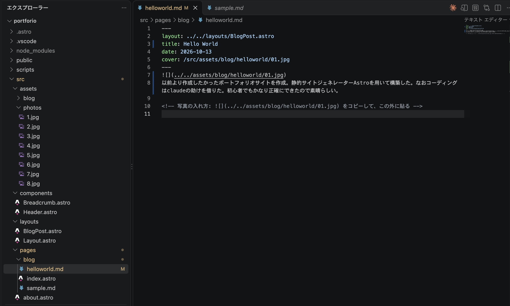

以前より作成したかった個人サイトを作成。Astroを用いて構築した。なおコーディングはClaudeの助けを借りた。プログラミング初心者でもかなり正確にできたので素晴らしい。

サイトを作った経緯としては、もともとBlogを書いてみたかったこと、それと同時に写真を展示できる場が欲しかったことがある。当初はnoteで書くことを検討していたが、最近のnoteの生成AIによる汚染状況や検索エンジンが終わっていることなどからnoteから離れたくなった。またnoteでなく個人サイトということで、自分の居場所であるが故に気を遣って文章を書く必要が薄れることもある。例えばnoteでだ・である口調を使っていると若干上から目線だと感じるが、個人サイトならばおかしくないように思える。個人的にだ・であるの方が冗長にならないため好みである。

Astroをチョイスした理由としては、簡単に述べると 
・JSをなるべく使わず、必要な箇所に限定してスクリプトを読み込ませられる 
　→コンパイル時の不要なコードが削ぎ落とされるが故にページの読み込みが非常に早い 
　→検索エンジンに引っかかりやすい 
・標準でMarkdownやMDXに対応している 
　→テキスト中心の大規模なコンテンツ管理が外部CMSなしでも容易に行える 
・サーバーサイドの動的処理やデータベースとの常時接続が発生しない 
　→動的サイトの弱点である不正アクセス・改ざんのリスクがない 
　→またサーバー費を（現状）0に抑えることができる 
これらのメリットから、Astroを用いてこの個人サイトを構築した。

前述した通り、筆者はプログラミング初心者であり、コーディングはClaudeの助けを借りた。しかもこれは無料版のみである。 
勘の良いガキはスクショのVS CodeにClaudeの拡張機能が入ってるじゃないかと気づくかもしれないが、これがPro以上の機能だと知らなかっただけだ。気にするな。 
筆者の出身の逸般中学ではなぜかHTMLとCSSとVSを触らされ、HPの構築をした経験があったので、プログラムをある程度読むことができた。ただ、このサイトを構築するほどの力量はなかったため、Claudeを活用した。基本的にはデザイン、方向性、機能の実装方法などはこちらから指定した。いわゆる<i>Vibe Coding</i>である。トークンを消費しすぎないよう最初に枠組みを作ってから、個別の問題を解決するために別のチャットを立てて修正を続けていった。開発を始めてから3時間ほどでサイトの枠組みは完成し、修正を重ね続けて4日間で公開できるまでのレベルにできたことは、まさにVibe Codingの良さが際立っているように思う。Claudeが優秀というのもあるだろうが、当サイトのデザインがミニマリズムに基づいており、最小限の文字・動きでデザインしていることもClaudeで構築しやすかった要因の一つのように思う。

さて、ややこいプログラミングの話を殴り書きしたところで、当サイトの最初のブログを締めようと思う。よろしければ皆さんも個人サイトを持ってみてはいかがだろうが？

<!-- 写真の入れ方:  をコピーして、この外に貼る -->

